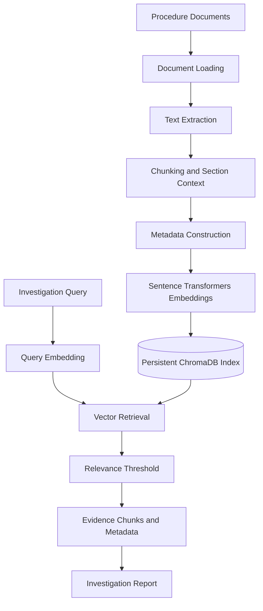

# RAG Design — Alarm Investigation and Procedure Guidance Copilot

## 1. Objective

The Retrieval-Augmented Generation (RAG) component retrieves relevant procedure-document evidence to support alarm investigation.

It complements structured alarm and asset information obtained through MCP. The objective is to ground the investigation report in available evidence, provide source citations, and communicate uncertainty when the evidence is insufficient.

The current corpus contains demonstration procedures. These documents are synthetic and are not approved operational instructions.

## 2. Architecture

The RAG workflow is implemented in `rag_pipeline.py`.

## 3. Document Corpus

Procedure documents are stored under `rag/documents/`.

The current corpus includes:

- `motor_trip_procedure.md`
- `sample_motor_trip_procedure.txt`
- `pump_troubleshooting.md`
- `sample_procedures.txt`

The corpus contains motor-trip and pump-troubleshooting material used for demonstration and testing.

**Trust boundary:** the documents are not approved operational procedures. Their contents must not be used as authorization to perform physical operations.

## 4. Document Loading and Text Extraction

The pipeline loads supported documents using the logic in `load_document()`.

Supported processing includes plain-text and Markdown documents, with additional document formats handled where implemented by the loader.

The extracted text is passed to the chunking and metadata-building stages. Unreadable documents or documents without usable text should not be treated as valid evidence.

The precise supported file extensions should be confirmed from `load_document()` before extending this documentation to other formats.

## 5. Chunking Strategy

The current chunking configuration is:

| Setting | Value |
|---|---:|
| Chunk size | 1,200 characters |
| Chunk overlap | 150 characters |
| Chunking method | Character-based splitting |
| Markdown handling | Section-aware chunking with heading context |

For Markdown documents, the pipeline separates sections and retains heading context in each chunk. Long sections are split into overlapping chunks.

Overlap helps preserve context across chunk boundaries. The chunk size is a character count, not a token count.

These settings are initial implementation choices and may need evaluation against larger or more varied procedure documents.

## 6. Metadata

The pipeline builds document metadata and associates it with each indexed chunk.

Available metadata fields include:

- Source filename
- Document identifier
- Document title
- Revision
- Approval status
- Asset types
- Section
- Chunk index

Metadata supports source attribution and helps the report communicate where retrieved evidence came from.

Metadata is derived from the document and file information available to the implementation. Missing values should not be invented.

## 7. Embedding Generation and Index Storage

The embedding model is loaded using Sentence Transformers and cached within the Python process.

Document chunks are embedded and stored in a persistent ChromaDB collection.

The index is stored at:

`data/chroma_db`

ChromaDB is configured to use L2 distance for vector comparison.

The index-building workflow processes prepared chunks in batches. Index rebuilding and document updates must be validated to ensure that stale chunks are not retained.

## 8. Retrieval Workflow

The `search_procedures()` function performs the following steps:

1. Opens the persistent ChromaDB collection.
2. Checks the available indexed content.
3. Generates an embedding for the incoming search query.
4. Queries ChromaDB for candidate chunks.
5. Reads each candidate's text, metadata, and distance.
6. Applies the configured relevance threshold.
7. Returns matching chunks with their source metadata.

The current implementation uses vector retrieval. Hybrid keyword-plus-vector search and a separate cross-encoder reranker should not be assumed to exist.

The relevance threshold is based on ChromaDB's L2-distance behavior. Lower distance generally indicates a closer vector match, but this does not guarantee that the text is factually correct or operationally approved.

## 9. Citations and Grounded Reporting

Retrieved evidence includes source information and metadata used by the report-generation component to construct citations.

The report should distinguish:

- Facts retrieved from the alarm API
- Evidence retrieved from procedure documents
- Possible explanations that remain unconfirmed
- Recommendations that require independent operational validation
- Warnings arising from synthetic or insufficient evidence

A citation identifies the evidence used; it does not prove that the document is approved or that its instructions are safe to execute.

## 10. Low-Confidence and No-Result Handling

The retrieval pipeline filters weak matches using a relevance threshold.

When evidence is absent or insufficient, the investigation report must not claim that a procedure has been verified. The report-generation component includes fallback behavior and safety warnings for cases where usable evidence is unavailable.

The system should preserve uncertainty instead of manufacturing a root cause or presenting unsupported procedural claims.

The threshold should be evaluated against representative queries and relevant and irrelevant documents before being treated as a production-quality confidence measure.

## 11. Prompt-Injection and Trust Boundaries

Retrieved document text must be treated as untrusted reference data.

The application should not follow instructions embedded in retrieved documents that attempt to change system behavior, override application rules, reveal secrets, or bypass safety controls.

The report-generation component should treat procedure content as evidence rather than executable instructions.

Prompt-injection resistance must be tested explicitly. It should not be considered fully validated solely because the report contains safety warnings.

## 12. Rebuilding the Index

The source documents and the persistent index are separate artifacts.

When procedure documents change, the index should be rebuilt or updated using the project's indexing workflow. The resulting index should be checked for:

- Successful document loading
- Expected chunk count
- Correct source metadata
- Removal of stale content
- Relevant retrieval results
- Correct citations

Document revisions and approval-status changes must be reflected in the indexed metadata.

## 13. Testing Strategy

The current RAG tests cover:

- Empty input handling
- Chunk creation
- Long-text splitting
- Markdown heading context
- Metadata extraction
- Missing metadata behavior
- Handling missing fields
- Avoiding unsupported asset-type guesses

Further assessment testing should cover:

- Retrieval relevance
- Citation correctness
- No-result behavior
- Low-confidence behavior
- Document update and stale-index handling
- Prompt-injection attempts
- End-to-end MCP-plus-RAG workflow
- Failure of the retrieval component during an investigation

## 14. Current Limitations and Future Improvements

Current limitations include a small synthetic corpus, local persistent vector storage, character-based chunking, and a relevance threshold that requires further evaluation.

Potential improvements include:

- Expanding the corpus with approved, version-controlled documentation
- Adding automated retrieval-quality evaluation
- Evaluating hybrid search where appropriate
- Testing prompt-injection resistance systematically
- Improving document revision and stale-index management
- Measuring retrieval latency and quality against a representative dataset
- Adding access controls for documents with different trust or confidentiality levels

The current RAG implementation is intended for demonstration and evaluation, not independent operational decision-making.
